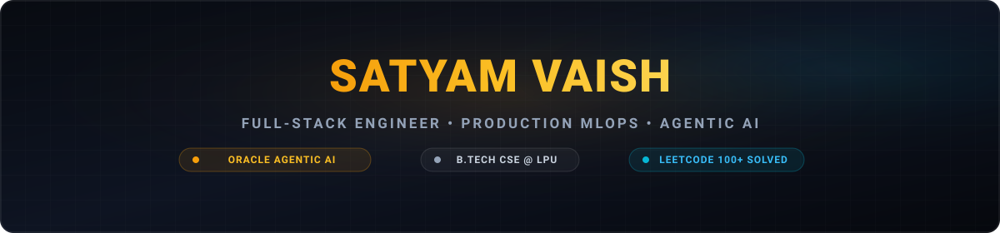

<!-- ===================================================== -->
<!--              SATYAM VAISH - PROFILE README             -->
<!-- ===================================================== -->

  

  

    
  

  

    
    
    
    
  

---

## 👋 About Me

Hi! I'm **Satyam Vaish**, a **B.Tech Computer Science and Engineering** student at **Lovely Professional University (LPU)** specializing in **Full-Stack Engineering, Production MLOps, Agentic AI**, and **Quantitative Market Systems**.

- ⚡ **Production MLOps & Systems:** Designing automated end-to-end ML pipelines with **FastAPI, LightGBM, XGBoost, MLflow, DVC, Pandera**, and Docker.
- 💻 **Full-Stack Web Engineering:** Building responsive, high-performance web applications using **Next.js, React.js, TypeScript, Tailwind CSS, Node.js, Express**, and **C++17**.
- 🤖 **AI / Machine Learning:** **Oracle Certified in Agentic AI** & Generative AI; experienced in feature pipelines, SHAP explainability, and real-time distribution drift tracking.
- 📈 **Market Intelligence:** Engineered an institutional-grade **Gold (XAU/USD) Top-Down Analysis** platform with multi-timeframe price action, liquidity mapping, WebSockets, and predictive signals.
- 🧩 **Algorithmic Problem Solving:** Solved **100+ problems on LeetCode** with continuous focus on data structures, system design, and algorithmic efficiency.

---

## 🚀 Featured Projects

### 1. ⚡ [CREDENCE — Production Credit Default Risk Engine & MLOps Platform](https://github.com/satyam-vaish/CREDENCE)

An enterprise-grade, end-to-end credit risk scoring and drift-monitoring platform built for production financial infrastructure.

- **Dual-Model ML Architecture:** Trains and evaluates calibrated **LightGBM** and **XGBoost** pipelines with isotonic calibration, optimal threshold tuning based on cost curves, and SHAP counterfactual explanations.
- **Production MLOps Pipeline:** Experiment tracking with **MLflow**, configuration management with **Hydra**, data lineage with **DVC**, schema enforcement via **Pandera**, and **>90% unit test coverage**.
- **Real-Time Drift Engine:** Continuously tracks Population Stability Index (PSI) and Kolmogorov-Smirnov drift across 47+ historical batches with automated retraining triggers.
- **Ultra-Low Latency Dashboard:** High-frequency FastAPI backend (<20ms response) paired with an interactive Vite + React dark-mode financial terminal featuring 60fps physics animations and mock mode.
- **Cloud-Native Deployment:** Multi-service orchestration ready for **Vercel** and **Render** with complete Docker and GitHub Actions CI/CD automation.

**Stack:** `Python` · `FastAPI` · `LightGBM` · `XGBoost` · `Scikit-learn` · `MLflow` · `React` · `TypeScript` · `Vite` · `Docker` · `Vercel`

  

---

### 2. 🥇 [Gold (XAU/USD) Top-Down Analysis Platform](https://github.com/satyam-vaish/Gold-Xau-usd-Top-to-Down-Analysis)

An institutional-grade **XAU/USD (Spot)** & **GC1! (COMEX Futures)** market intelligence platform built with a real-time trading-terminal UI.

- Built a structured **top-down analysis** workflow for Gold (`XAU/USD`), establishing directional bias on higher timeframes and refining entries on lower timeframes.
- Applied **price action & multi-timeframe market structure analysis** (BOS, CHoCH, MSS, HH/HL/LH/LL) across 11 timeframes (`1M` – `1M`).
- Marked key **support/resistance, supply/demand (FVG & Order Blocks), and liquidity levels (BSL/SSL, PDH/PDL, PWH/PWL)** with documented reasoning.
- Aligned lower-timeframe entry confirmations with higher-timeframe directional bias and integrated real-time WebSocket streaming, backtesting, and predictive analytics.

**Stack:** `Next.js` · `TypeScript` · `Tailwind CSS` · `TradingView Lightweight Charts` · `WebSockets` · `FastAPI` · `Scikit-learn` · `PostgreSQL`

  

---

## 🧰 Technical Skills

### Programming Languages

  
  
  
  
  
  
  
  

### Frontend & Backend Engineering

  
  
  
  
  
  
  
  

### Machine Learning & MLOps

  
  
  
  
  
  
  
  

### Cloud, DevOps & Databases

  
  
  
  
  
  
  
  

---

## 📜 Certifications & Training

| Category | Title | Issuer / Institution | Period / Date |
|---|---|---|---|
| **Certification** | **Oracle Agentic AI Certified Foundations Associate** | Oracle | Sep 2026 |
| **Certification** | **Generative AI** | Udemy | Jul 2026 |
| **Certification** | **Intro to AI** | Udemy | Sep 2026 |
| **Certification** | **AI for Everyone** | Online Specialization | Sep 2026 |
| **Training** | **Programming in JAVA** | Lovely Professional University | Jan 2026 – May 2026 |
| **Training** | **Data Structures & Algorithms (DSA)** | Lovely Professional University | Jul 2025 – Jan 2026 |
| **Training** | **Object Oriented Programming (OOP)** | Lovely Professional University | Jul 2025 – Jan 2026 |
| **Training** | **Computer Programming** | Lovely Professional University | Jan 2025 – May 2025 |

---

## 🎓 Education & Achievements

- **Bachelor of Technology in Computer Science and Engineering** — *Lovely Professional University, Punjab, India* (`Aug 2024 – Present` · **CGPA: 7.49**)
- **Intermediate (12th)** — *Kendriya Vidyalaya, Nasik, Maharashtra* (`Mar 2021 – Mar 2022` · **83%**)
- **Matriculation (10th)** — *Kendriya Vidyalaya, Nasik, Maharashtra* (`Mar 2022 – Mar 2023` · **78.8%**)
- 🏆 **Achievements:** Solved **100+ problems on LeetCode**, earned multiple **Python badges on HackerRank**, and created production-grade full-stack & MLOps architectures.

---

## 📊 GitHub Statistics

  

  

   

  

---

## 🤝 Connect With Me

  
  
  

  
<i>Problem-solving · Team Collaboration · Adaptability · Continuous Learning</i>

