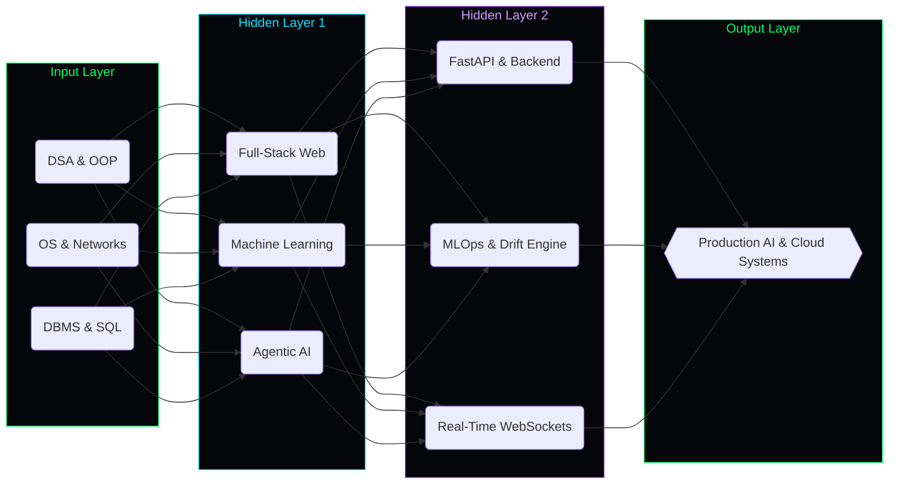

<div align="center">


<a href="https://github.com/satyam-vaish">
  
</a>

<br/>


<br/>

<a href="https://github.com/satyam-vaish?tab=followers"></a>

</div>

<br/>

<div align="center">

## `◈ 01 — MODEL_SUMMARY`

</div>

I'm **Satyam Vaish**, a B.Tech CSE student at Lovely Professional University, engineering production-grade full-stack, MLOps, and Agentic AI systems — independently, from scratch, end to end.

> *"I don't build projects for marks. I build production-grade systems that solve real problems."*

```text
Model: "satyam_vaish"
┌─────────────────────┬──────────────────────────────────────────────┐
│ Layer (type)        │ Output                                       │
├─────────────────────┼──────────────────────────────────────────────┤
│ input_foundations   │ DSA · OOP · OS · DBMS · Computer Networks    │
│ dense_fullstack     │ Next.js · React · TypeScript · FastAPI · C++ │
│ attention_mlops     │ LightGBM · XGBoost · MLflow · DVC · Docker   │
│ agentic_ai          │ Oracle Agentic AI · GenAI · Tool Orchestration│
│ market_intel        │ Quantitative Price Action · WebSockets · XAU │
│ output_production   │ Shipped, deployed, low-latency architectures │
└─────────────────────┴──────────────────────────────────────────────┘
Optimizer: curiosity   |   Loss: shipping bugs   |   Status: training
```

**Right now** — shipping `CREDENCE`, a production-grade credit default risk scoring & real-time drift monitoring MLOps platform.

<br/>

<div align="center">

## `◈ 02 — NETWORK_ARCHITECTURE`

<sub>how foundations flow into production systems</sub>

</div>



<br/>

<div align="center">

## `◈ 03 — LAYERS (TECH_STACK)`

**Languages**


**Frontend**


**Backend & Systems**


<br/>


**AI & Machine Learning**


<br/>


**MLOps & Cloud DevOps**


<br/>


**Databases & Storage**


</div>

<br/>

<div align="center">

## `◈ 04 — TRAINING_RUNS (PROJECTS)`

<sub>pulled from <a href="https://github.com/satyam-vaish?tab=repositories">github.com/satyam-vaish</a> — real repositories only</sub>

</div>

<table width="100%">
<tr>
<td width="50%" valign="top">

### ⚡ CREDENCE
  

Production Credit Default Risk Engine & Real-Time Drift Monitoring Platform.

- Calibrated LightGBM + XGBoost with isotonic tuning & cost curves
- Real-time PSI & Kolmogorov-Smirnov drift across 47+ historical batches
- High-frequency FastAPI backend (<20ms response) + Vite React UI
- Full MLOps: MLflow, Hydra, DVC, Pandera, Docker, Vercel & Render CI/CD

**[→ View Repository](https://github.com/satyam-vaish/CREDENCE)**

</td>
<td width="50%" valign="top">

### 🥇 Gold-Xau-usd-Top-to-Down-Analysis
  

Institutional-grade Gold (XAU/USD Spot & GC1! Futures) multi-timeframe price action intelligence platform.

- Multi-timeframe market structure (BOS, CHoCH, Order Blocks, Liquidity Sweeps)
- 11 timeframe analysis (`1M` – `1M`) with documented reasoning
- Real-time WebSocket streaming with TradingView Lightweight Charts
- FastAPI backend with Scikit-learn predictive signals & backtesting

**[→ View Repository](https://github.com/satyam-vaish/Gold-Xau-usd-Top-to-Down-Analysis)**

</td>
</tr>
</table>

<br/>

<div align="center">

## `◈ 05 — TRAINING_LOGS (ANALYTICS)`


<!-- Streak: bump v= to force GitHub to refetch -->


</div>

<br/>

<div align="center">

## `◈ 06 — INFERENCE`

</div>

```python
>>> from satyam import Engineer
>>> model = Engineer.load("production")
>>> model.predict("mission-critical fullstack & AI systems")
[████████████████████] 100%   output: shipped ✔

>>> model.goal
'Engineer high-performance full-stack architectures and production MLOps systems'

>>> model.fit(epochs=float("inf"))
Epoch 1/∞ ... loss ↓  skills ↑  _
```

<div align="center">

## `◈ 07 — CONNECT`

<a href="https://www.linkedin.com/in/satyam-vasih07/"></a>
<a href="https://github.com/satyam-vaish"></a>
<a href="mailto:mr.satyamv07@gmail.com"></a>

</div>


<div align="center"><sub>⚡ Weights updated. See you in the next commit. ⚡</sub></div>
